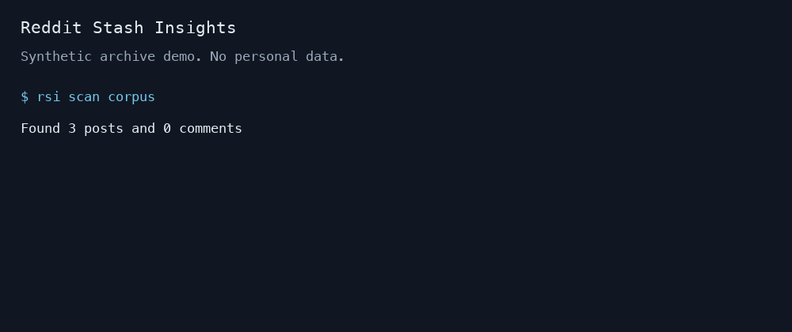

# Reddit Stash Insights

[](https://www.python.org/)
[](https://github.com/rhnfzl/reddit-stash-insights/actions/workflows/compatibility.yml)
[](LICENSE)

> Companion to [reddit-stash](https://github.com/rhnfzl/reddit-stash), adds semantic search and AI chat to your Reddit archive.



## How It Works

**reddit-stash** saves your Reddit content as markdown files. **reddit-stash-insights** indexes those files and lets you search and chat with them:

```
reddit-stash saves  -->  rsi indexes  -->  search & chat
   (markdown)          (BGE-M3 + LanceDB)    (RAG + LLM)
```

## Features

- **Hybrid search:** combines semantic (BGE-M3, 1024-dim) and keyword (BM25 via Tantivy) search with RRF reranking
- **RAG chat:** ask questions about your archive using local or cloud LLMs with streaming responses
- **Bounded evidence:** packs complete passages within the chat model budget and cites only included sources
- **Multiple LLM providers:** llama-cpp (local GGUF), Ollama, OpenAI-compatible (vLLM, LM Studio)
- **Local fallback:** switches between local providers; cloud fallback requires explicit consent
- **MCP server:** expose search and chat as tools for Claude Code
- **Streamlit UI:** web-based chat interface with source citations
- **S3 support:** fetch reddit-stash data directly from S3 buckets
- **Repeatable evaluation:** packaged questions, reference answers, relevance labels, and retrieval metrics
- **CLI:** scan, index, search, chat, UI, evaluation, health checks, and MCP service

## Quick Start

```bash
pip install "reddit-stash-insights[search]"
rsi index ~/reddit                   # Build search index (first run downloads ~2GB model)
rsi search "best python libraries"   # Search your archive
```

To add AI chat:

```bash
pip install "reddit-stash-insights[search,chat-ollama]"
# Install Ollama and pull a model first; see the provider guide below.
rsi chat --provider ollama --model qwen2.5:7b "What did I save about Python async programming?"
```

## Getting Your Archive

reddit-stash saves to Dropbox, to S3 (under the `reddit/` prefix) or to a local folder. `rsi` needs a local copy:

```bash
rsi index ~/reddit                              # Local reddit-stash output
rsi index ~/reddit --s3-bucket <bucket>         # Fetch s3://<bucket>/reddit/ first, then index
aws s3 sync s3://<bucket>/reddit/ ./reddit --exclude '.reddit-stash/*'   # Or sync it yourself
```

Dropbox users can sync or download the reddit-stash folder and point `rsi` at it.

Notes:
- Every reddit-stash file type is indexed: your own posts and comments (`POST_`, `COMMENT_`), saved (`SAVED_`), upvoted (`UPVOTE_`) and GDPR exports (`GDPR_`). An item that is both saved and upvoted is indexed once.
- The `.reddit-stash/` folder holds reddit-stash's control files and is skipped.
- `file_log.json` may contain failure entries without a `type`; these are ignored.
- `rsi index` updates the existing index in place (rows are upserted, so re-running never duplicates them). After upgrading from a version that indexed only `POST_`/`COMMENT_` files, delete the index (`~/.rsi/index/vectors.lance` by default) and run `rsi index` again so saved and upvoted items appear.

## Installation

```bash
pip install reddit-stash-insights           # Core only (scan)
```

### Source installation

```bash
git clone https://github.com/rhnfzl/reddit-stash-insights.git
cd reddit-stash-insights
pip install -e ".[dev]"
```

Install extras for additional features:

| Extra | What it adds | Key dependencies |
|-------|-------------|-----------------|
| `search` | Semantic + keyword search | sentence-transformers, LanceDB, FlagEmbedding |
| `index` | Vector storage without local embedding models | LanceDB |
| `embed-openai` | OpenAI-compatible embeddings API | openai, tiktoken |
| `chat` | Local LLM inference | llama-cpp-python |
| `chat-ollama` | Ollama LLM provider | requests |
| `chat-openai` | OpenAI-compatible provider | openai |
| `mcp` | MCP server for Claude Code | mcp |
| `ui` | Streamlit chat interface and index access | streamlit, LanceDB |
| `all` | Everything above | All listed dependencies |

```bash
# Common combinations
pip install "reddit-stash-insights[search,chat-ollama,ui]" # Local search and Ollama chat UI
pip install "reddit-stash-insights[all]"                   # Includes compiled llama-cpp support
pip install "reddit-stash-insights[search,chat-openai]"    # Search + OpenAI/vLLM
```

## Usage

### Scan

Inspect a reddit-stash directory without indexing:

```bash
rsi scan ~/reddit
# Found 1523 posts and 847 comments
```

### Index

Build or update the vector search index:

```bash
rsi index ~/reddit
rsi index ~/reddit --s3-bucket my-bucket  # Fetch from S3 first, then index
```

### Search

Query your indexed content with three search modes:

```bash
rsi search "machine learning papers"              # Hybrid (default)
rsi search "transformers" --mode semantic          # Semantic only
rsi search "python tutorial" --mode keyword        # BM25 keyword only
rsi search "rust" --subreddit programming -n 5     # Filter by subreddit
```

### Chat

Ask questions using RAG with your preferred LLM:

```bash
# Single question (streams response by default)
rsi chat "summarize my saved cooking recipes"

# Interactive REPL with conversation history
rsi chat
# you> what did I save about sourdough starters?
# you> /sources    (show source documents)
# you> /clear      (reset history)
# you> /quit

# Override provider for a session
rsi chat --provider ollama --model qwen2.5:7b
rsi chat --provider openai --model gpt-4o
```

### Streamlit UI

Launch the web-based chat interface:

```bash
pip install "reddit-stash-insights[search,chat-ollama,ui]"
rsi ui
```

The UI opens on `127.0.0.1:8501`. Use `rsi ui --port 8502` if that port is busy.
Configure a working LLM provider before asking chat questions.

### Evaluation

The reusable evaluator accepts your own private questions and source labels.
Keep personal data and every derived report outside Git. Only fictional examples are public.
The evaluator scores retrieval; it does not train model weights or judge chat answers.

Run the packaged synthetic check without downloading a model or providing private data:

```bash
pip install "reddit-stash-insights[index]"
rsi eval --fixture --mode keyword --split all --output /tmp/rsi-fixture.json
```

Reports include recall@10, MRR@10, nDCG@10, per-query rankings, errors, latency, and input hashes.
The 50 answerable questions and 10 absent controls have source-checked answers and independent agent review.
Synthetic scores check the runner; they do not establish real archive quality or superiority over another search system.
See [evaluation instructions](https://github.com/rhnfzl/reddit-stash-insights/blob/main/docs/evaluation.md) for frozen-corpus evaluation and judgment limits.

### MCP Server

Expose your Reddit archive as tools for Claude. Works with both the Claude desktop app and Claude Code.

```bash
pip install "reddit-stash-insights[search,chat-ollama,mcp]"
```

This exposes two tools:

| Tool | Description |
|------|-------------|
| `reddit_search` | Search your archive (no LLM needed for results) |
| `reddit_chat` | Ask questions with RAG, retrieves context and generates answers |

See [MCP setup](https://github.com/rhnfzl/reddit-stash-insights/blob/main/docs/mcp.md) for Claude desktop and Claude Code examples.

## Configuration

Settings live in `~/.rsi/config.toml`. Minimal example:

```toml
[llm]
provider = "llama-cpp"
model = "~/.rsi/models/qwen2.5-7b-instruct-q4_k_m.gguf"
allow_cloud_fallback = false

[chat]
context_docs = 5
search_mode = "hybrid"
```

Environment variables override config file values (e.g., `RSI_LLM_PROVIDER`, `RSI_S3_BUCKET`).

See [configuration](https://github.com/rhnfzl/reddit-stash-insights/blob/main/docs/configuration.md) for the full reference.

## LLM Providers

| Provider | Type | Best for |
|----------|------|----------|
| `llama-cpp` | Local GGUF | Privacy, offline use, no API costs |
| `ollama` | Local HTTP | Easy model management, multiple models |
| `openai` | Cloud/API | OpenAI-compatible endpoints, including vLLM and LM Studio |

The system checks the selected provider, then tries local alternatives (`llama-cpp`, `ollama`).
OpenAI-compatible fallback requires `[llm].allow_cloud_fallback = true` or `RSI_ALLOW_CLOUD_FALLBACK=true`.
Selecting `openai` directly also permits API calls. Retrieved context and conversation history go to that endpoint.
CLI and UI show the selected destination before generation. MCP advertises configured destinations during tool discovery.
Embedding privacy is configured separately: `embedding.provider = "openai"` sends indexed text and search queries to its API.

See [provider setup](https://github.com/rhnfzl/reddit-stash-insights/blob/main/docs/providers.md) for model installation instructions.

## Feedback

Use [Discussions](https://github.com/rhnfzl/reddit-stash-insights/discussions) for questions and feature requests.
Report a missed result with the [search that failed form](https://github.com/rhnfzl/reddit-stash-insights/issues/new?template=search-failed.yml).
Share sanitised examples only. Keep private archives, queries, usernames, paths, and credentials out of public reports.

## Development

```bash
pip install -e ".[all,dev]"

# Tests (unittest, not pytest)
python -m unittest tests.test_models tests.test_parser tests.test_scanner tests.test_cli tests.test_config -v  # Core
python -m unittest tests.test_chat_providers tests.test_chat_engine tests.test_cli_chat -v                     # Chat (mocked)
python -m unittest tests.test_embedder tests.test_vector_store tests.test_search tests.test_cli_search -v      # Search (slow, loads model)

# Lint
ruff check src/ tests/

# Multi-version testing
nox              # All sessions (3.11-3.14)
nox -s core      # Core tests only
```

## Architecture

The system is organized in layers: **Core** (parsing, scanning) -> **Indexer** (embedding, vector store, search) -> **Chat** (RAG engine, LLM providers) -> **UI/MCP** (Streamlit, MCP server). Each layer depends only on the ones below it.

See [architecture](https://github.com/rhnfzl/reddit-stash-insights/blob/main/docs/architecture.md) for the full system design.

## License

[MIT](https://github.com/rhnfzl/reddit-stash-insights/blob/main/LICENSE)

### Existing index migration

Passage indexing retains evidence from long threads and returns each source thread once.
Existing whole-document indexes remain readable. Build passages in a separate directory:

```bash
rsi index ~/reddit --db-path ~/.rsi/index/passages.lance
RSI_DB_PATH=~/.rsi/index/passages.lance rsi health
```

Point `RSI_DB_PATH` at the new directory after validation. Keep the old index for rollback.
The writer refuses legacy schemas and changed chunk settings. An explicit `--rebuild` discards the selected table.
See [index settings and migration](https://github.com/rhnfzl/reddit-stash-insights/blob/main/docs/configuration.md#embedding-providers) for identity fields and retry behavior.
